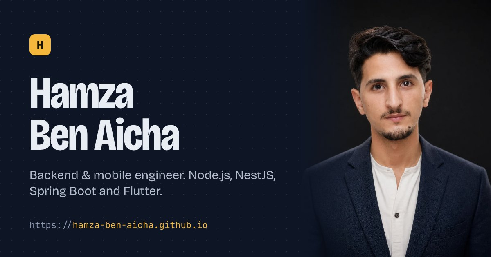

# Hamza Ben Aicha · Portfolio

Personal site of Hamza Ben Aicha, backend and mobile engineer.
Live at **https://hamza-ben-aicha.github.io/**



## What's inside

- **Interactive API console** in the hero: pick `/me`, `/projects` or `/stack` and watch the JSON response stream in.
- **Case studies** for each project: overview, what I built, the hard part, the stack and an architecture diagram. Each one has its own link, for example `/#work/vclub`.
- **English and French**, dark and light themes (both remembered per visitor).
- **Downloadable CVs** (backend, Flutter and French versions) in `public/cv`.
- Animations with [Motion](https://motion.dev), all disabled when the visitor prefers reduced motion.

## Stack

React 19, Vite, Motion, self-hosted Bricolage Grotesque and JetBrains Mono fonts. No CSS framework: one hand-written stylesheet in `src/styles.css`.

## Editing content

All text lives in [`src/content.js`](src/content.js), in English and French:

- `projects`: case studies. To use a real screenshot, replace the matching image in `public/projects/` (1600 × 1000 works best).
- `experience`, `education`, `skills`: the timeline and the About section.
- `apiResponses`: what the hero console returns.

## Run locally

```bash
npm install
npm run dev      # http://localhost:5173
npm run build    # production build in dist/
```

## Deploy

Every push to `master` builds the site and publishes it to GitHub Pages through
[`.github/workflows/deploy.yml`](.github/workflows/deploy.yml).
One-time setup: **Settings → Pages → Source: GitHub Actions**.

The old address (`/MyPortfolio/`) redirects to the new one.
